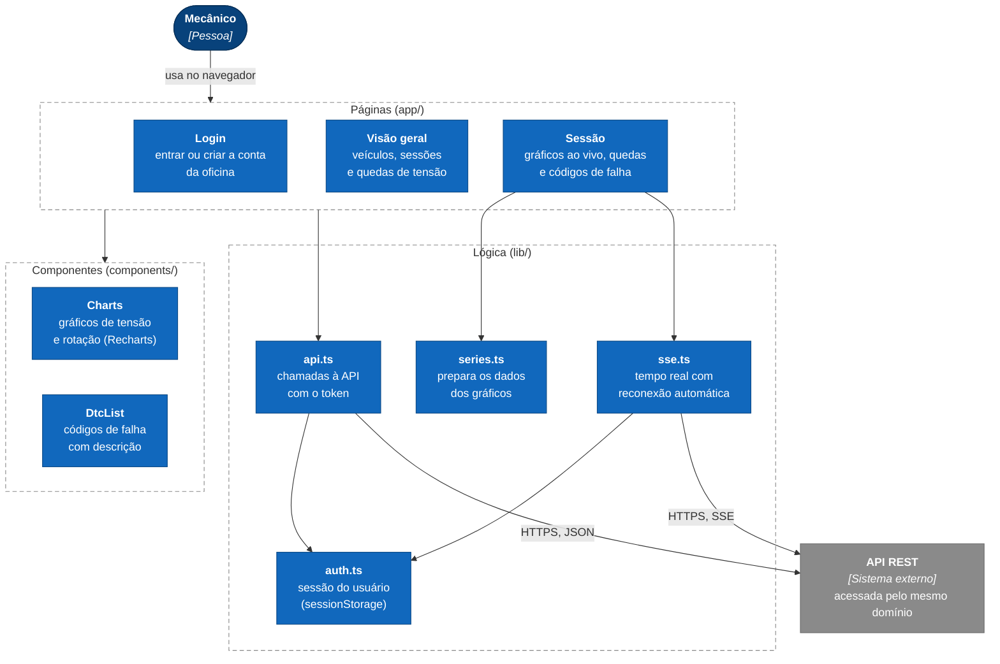

# Telemetria Automotiva Remota: Painel Web

[](https://github.com/SamuelMorsch/painel-telemetria-web/actions/workflows/ci.yml)
[](https://sonarcloud.io/summary/new_code?id=SamuelMorsch_painel-telemetria-web)
[](https://sonarcloud.io/summary/new_code?id=SamuelMorsch_painel-telemetria-web)

Painel da oficina. O mecânico acompanha, **em tempo real**, a tensão elétrica, a rotação, a
velocidade e a temperatura de um veículo que está rodando na rua, e vê onde ocorreram **quedas de
tensão** com o motor girando: o tipo de defeito intermitente que não aparece com o carro parado na
oficina.

> Este é um dos três módulos do sistema. A visão geral, a arquitetura, os requisitos e o vídeo de
> demonstração estão no **[README principal](https://github.com/SamuelMorsch/telemetria-api)**.
> Os outros módulos são o [app Android](https://github.com/SamuelMorsch/telemetria_obd2_app) e a
> [API](https://github.com/SamuelMorsch/telemetria-api).

**Painel no ar:** https://telemetria-tcc.duckdns.org

## O que o painel faz
- **Login** por oficina. A conta é criada na própria tela de entrada.
- **Visão geral:** veículos, sessões recentes (com o selo "Ao vivo") e quedas de tensão detectadas.
- **Sessão ao vivo:** gráficos de tensão e rotação atualizados a cada leitura (as últimas 300),
  valores atuais e alerta quando a tensão cai com o motor girando.
- **Sessão encerrada:** histórico completo, com as quedas destacadas no gráfico. Em sessões longas
  ele é resumido, mostrando a tensão **mínima** de cada intervalo, para a queda nunca sumir do gráfico.
- **Códigos de falha:** lista com a descrição em português e o estado de cada código (confirmado ou pendente).
- **Calibração:** o limite de tensão que define uma "queda" pode ser ajustado na tela.

## Como funciona



- **Só a API.** O painel não acessa banco nenhum: todo dado vem de `/api`.
- **Tempo real com SSE lido por `fetch`.** Assim o token vai no cabeçalho e **não na URL**, onde ficaria
  registrado em históricos e logs. Se a conexão cair, o painel **reconecta sozinho** e mostra
  "Reconectando…".
- **"Ao vivo"** significa que houve leitura nos últimos 2 minutos.
- As quedas são recalculadas quando o limite muda e a cada 10 s enquanto a sessão está ao vivo.

## Segurança
- O token de acesso fica em `sessionStorage` e **some ao fechar a aba**. É um compromisso
  documentado na [ADR 0001](docs/adr/0001-painel-consome-so-a-api-e-token-em-sessionstorage.md).
- Cabeçalhos de segurança em todas as respostas (`nosniff`, proibição de ser aberto em quadro e
  sem `Referer`) e o cabeçalho `X-Powered-By` removido.
- A imagem Docker roda **sem root** e contém só o necessário para executar o painel.

## Stack
Next.js 16 (App Router) · React 19 · TypeScript · Tailwind CSS 4 · Recharts · Jest e Testing Library.

## Rodando localmente
Requer Node 22+ e uma API em execução (a do projeto ou uma local).

```bash
npm install
cp .env.example .env.local      # define NEXT_PUBLIC_API_URL
npm run dev                     # http://localhost:3001
```
A API precisa liberar a origem do painel em `CORS_ORIGINS` (por exemplo, `http://localhost:3001`).

## Testes e qualidade
```bash
npm test                        # Jest, com relatório de cobertura
npm run lint
```
A cada alteração, o CI roda os testes, a análise do
[SonarQube Cloud](https://sonarcloud.io/summary/new_code?id=SamuelMorsch_painel-telemetria-web) e o
build de produção.

Os testes cobrem a lógica do painel: o cliente da API, a preparação das séries dos gráficos, a leitura
do fluxo SSE, a lista de códigos de falha e a tela de login. **As telas de visão geral e de sessão ainda
não têm testes de interface**, por isso a cobertura do projeto (veja o selo) é menor que a da API.

**Achados da análise estática e o que foi feito**

| Achado | Onde | O que era | Resolução |
|---|---|---|---|
| Promessa não tratada, 4 ocorrências (S9383) | `app/page.tsx` e `app/sessoes/[id]/page.tsx` | Funções assíncronas disparadas sem declarar que o resultado não é esperado. Todas já tinham `try/catch`. | Corrigido: marcadas com `void`, o mesmo padrão já usado no restante do código. Comportamento idêntico. |

## Produção
A cada merge na `main`, o CI publica a imagem Docker no GitHub Container Registry
(`ghcr.io/samuelmorsch/painel-telemetria-web`). O servidor **consulta o registro a cada 5 minutos** e
recria só o que mudou, sem SSH. Em produção o painel e a API ficam no mesmo domínio (o Caddy encaminha
`/api` para a API e o resto para o painel), então `NEXT_PUBLIC_API_URL` fica vazio. Os detalhes estão
em `infra/` no [repositório da API](https://github.com/SamuelMorsch/telemetria-api).

## Limitações conhecidas
- O painel depende da API e da internet: não funciona offline.
- O texto está só em português do Brasil.
- Os limites que definem uma queda de tensão são pontos de partida, a serem calibrados na validação em campo.

## Decisões de arquitetura
| ADR | Decisão |
|---|---|
| [0001](docs/adr/0001-painel-consome-so-a-api-e-token-em-sessionstorage.md) | O painel consome só a API, com token em `sessionStorage` e tempo real via `fetch` |

As decisões do sistema inteiro estão no [README principal](https://github.com/SamuelMorsch/telemetria-api).

## Contribuindo
Veja [`CONTRIBUTING.md`](CONTRIBUTING.md).

## Declaração de uso de inteligência artificial
Ferramentas de IA generativa foram usadas como apoio na revisão de código, na documentação e na
estruturação de textos. As decisões de arquitetura, a validação dos resultados e a autoria do
projeto são do autor.

## Licença
[MIT](LICENSE) © 2026 Samuel Morsch
